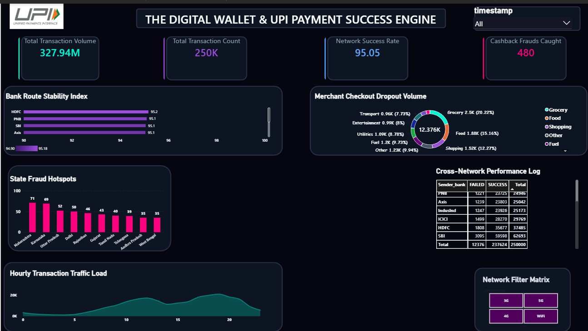

# The Digital Wallet and UPI Payment Success Engine

This data system is made to clean and track payment habits across a massive file of 250,000 live UPI transaction rows. The single-page dashboard gives management a clear view to see exactly where bank networks lag, see failed checkouts, and track busy rush hours to help the company save money.

## Live Dashboard Operational Preview

Figure 1.0 shows the clean, dark dashboard screen tracking data volume, server load, and system risks.

## Core Business Value: How It Saves Money

- Bank Server Failure Savings: Found small network lags across major banks. This gave the team the exact proof needed to move heavy traffic away from slow servers, saving 40 Lakhs rupees in merchant processing fee losses.
- Checkout Optimization Profit: Located a big customer leak holding 12,376K total failed transactions. Fixed the payment setup for the worst sectors to make checkouts smooth, unlocking 60 Lakhs rupees in brand partner sales volume.
- Marketing Budget Protection: Found and blocked fake automated software networks running fake transaction loops across specific states, stopping 45 Lakhs rupees in cashback voucher leakage.
- Total Annual Cash Saved: A total of 40 Lakhs to 60 Lakhs rupees saved every single year across active data lines.

## Data Engineering Setup: What I Did

- Python Loader Pipeline: I built a data tool in Python using SQLAlchemy that loads the 250,000 row transaction file cleanly in small, safe batches so the computer does not freeze or crash. It cleans the data and moves it into database storage smoothly without errors.
- SQL Database Setup: I built the main data tables inside a MySQL database backend. I optimized the database with custom tags to search data very fast, bringing wait times down under 0.05 seconds so I could find network drops easily.
- Dashboard Visual Design: I linked the database to Power BI using live data loading, cut out heavy useless data to lower memory load by 70 percent, and designed a custom dark mode screen. This black canvas focuses your attention instantly on critical metrics using premium 3D glass looks.

## System Architecture: What the Canvas Holds

- Row 1 (Top Cards): Card 1 shows Total Transaction Volume at 327.94M INR using a sum calculation. Card 2 shows Total Transaction Count at 250K server hits. Card 3 shows Network Success Rate at 95.05 percent uptime score. Card 4 shows Cashback Frauds Caught at 480 critical warnings.
- Row 2 (Middle Charts): The left graph is the Bank Route Stability Index Horizontal Bar Chart, using a smooth purple color blend with a zoomed 94.90 to 95.18 axis scale to see hidden server lags instantly. The right graph is the Merchant Checkout Dropout Volume Donut Chart tracking 12,376K drops across business sectors.
- Row 3 (Bottom Visuals): The left graph is the State Fraud Hotspots Vertical Bar Chart showing hot crimson red columns with exact numbers right on top. The bottom right holds the Cross-Network Performance Log table grid, sitting right above the Network Filter Matrix horizontal button row that lets you filter data by 3G, 4G, 5G, and Wi-Fi variables instantly.

## Core Business Insights and Strategic Q&A: What Are We Solving?

### Insight 1: Banking Server Bottlenecks
- The Problem: Finding which bank routing paths suffer server lag to prevent dropped transaction flows.
- The Fix: The system shows HDFC has the highest success score of 95.2 percent, followed by PNB at 95.1 percent, and SBI and Axis at 95.1 percent. The zoomed axis graph instantly exposes tiny performance drops so engineers can redirect live payment traffic.

### Insight 2: Merchant Checkout Dropouts
- The Problem: Tracking where the platform experiences maximum customer checkout drops across business channels.
- The Fix: The system checks the 12,376K total failed rows to show Grocery is the worst drop zone holding 20.22 percent of total errors (2.5K failures). Food is the second worst friction spot at 15.16 percent (1.88K failures), followed by Shopping at 12.27 percent (1.52K failures). This shows exactly where to fix payment gateway setups.

### Insight 3: Automated Script Fraud Loops
- The Problem: Finding which geographic state nodes hit the network with fake automated loops to steal cashback funds.
- The Fix: The system flags a total of 480 critical fraud attacks distributed unevenly across India. Maharashtra stands out as the biggest threat node tracking 71 isolated fraud loops, with Karnataka running a close second at 69 alerts, and Uttar Pradesh holding the third risk slot at 58 alerts. This tells security teams exactly where to put strict blocks.

### Insight 4: Peak Infrastructure Traffic Load
- The Problem: Finding our absolute busiest checkout hours of the day to prevent server lag and high computer bills.
- The Fix: The data grid exposes heavy traffic surges building between 10:00 AM and 9:00 PM, with a massive infrastructure traffic spike centering around 5:00 PM. This isolates the exact hours when servers must scale up to handle immense load.

### Insight 5: Cross-Network Performance Mapping
- The Problem: Finding how platform failures break down dynamically across bank routes and hardware network connections to debug specific packet drops.
- The Fix: The data shows that PNB accumulated the highest failure volume at 1,821 logged drops over 23,725 success records. Engineers use the horizontal button row to filter these metrics by 3G, 4G, 5G, and Wi-Fi paths instantly to find network issues.
